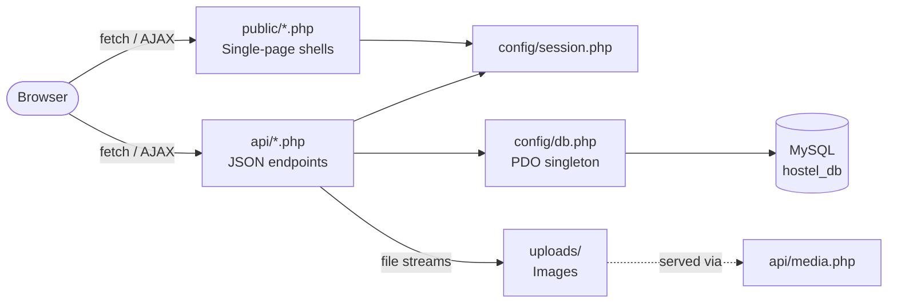
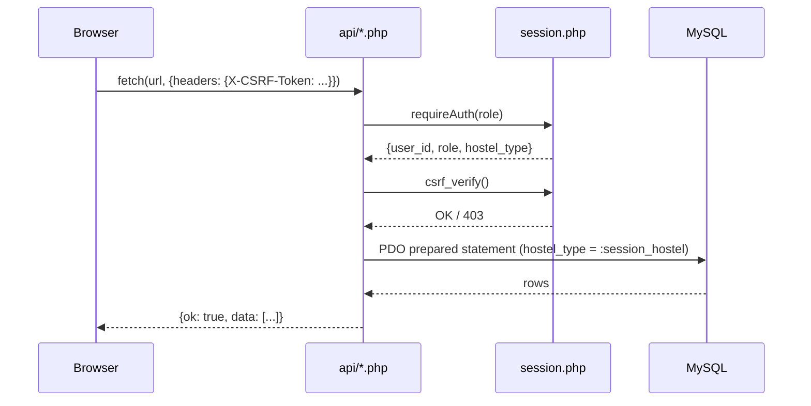
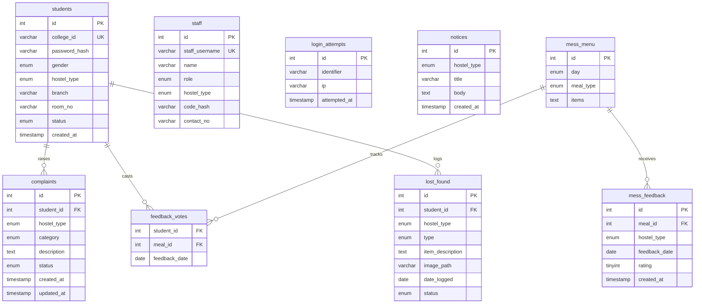

# Hostel Management System — IIIT Kota

A full-stack web application for managing boys' and girls' hostels at IIIT Kota.  
Built with **plain HTML/CSS/JS + PHP 8 (PDO) + MySQL**, targeting **XAMPP**. No frameworks, no CDN, no build tools.

---

## Table of Contents

1. [Features](#features)
2. [Architecture](#architecture)
3. [Database Schema](#database-schema)
4. [Prerequisites](#prerequisites)
5. [Installation & Setup](#installation--setup)
6. [Running the App](#running-the-app)
7. [Demo Credentials](#demo-credentials)
8. [Test Walkthrough](#test-walkthrough)
9. [API Reference](#api-reference)
10. [Configuration & Customization](#configuration--customization)
11. [Troubleshooting](#troubleshooting)

---

## Features

| Module | Student Portal | Staff Portal |
|---|---|---|
| **Authentication** | Register (email-format college ID), login, idle-timeout logout | Login with username + access code |
| **Complaints** | Raise, view own complaints; track status | View hostel complaints; mark in-progress / resolved |
| **Notices** | View notices for own hostel | Wardens: post and delete notices |
| **Mess Menu** | View shared weekly menu; rate today's meals (once per meal per day) | Wardens: edit menu items inline |
| **Mess Analytics** | — | View average ratings and feedback counts by day/meal |
| **Lost & Found** | Report lost/found items (with optional photo upload); view own hostel listings | Mark items resolved |
| **Student Approval** | View own status (pending / approved / rejected) | Wardens: approve or reject pending registrations |
| **Emergency Contacts** | View hostel emergency contacts | — |

**Security highlights:** PDO prepared statements, `ATTR_EMULATE_PREPARES=false`, role and hostel scope enforced server-side from `$_SESSION` only, CSRF token on every mutating request, brute-force rate limiting on login, `HttpOnly + SameSite=Strict` session cookies, 30-min idle timeout.

---

## Architecture

```
hostel_management/
├── config/
│   ├── db.php              ← PDO singleton (gitignored — copy from db.example.php)
│   ├── db.example.php      ← Template with XAMPP defaults
│   ├── session.php         ← Session hardening, requireAuth(), json_out(), csrf_token/verify()
│   └── contacts.php        ← Emergency contact data
├── api/                    ← One JSON endpoint per action
│   ├── auth_login_staff.php
│   ├── auth_login_student.php
│   ├── auth_logout.php
│   ├── auth_signup.php
│   ├── complaint_create.php
│   ├── complaint_list.php
│   ├── complaint_status.php
│   ├── lostfound_create.php
│   ├── lostfound_list.php
│   ├── lostfound_resolve.php
│   ├── media.php
│   ├── menu_update.php
│   ├── mess_analytics.php
│   ├── mess_feedback.php
│   ├── mess_menu.php
│   ├── notice_create.php
│   ├── notice_delete.php
│   ├── notice_list.php
│   ├── staff_complaint_list.php
│   ├── student_decide.php
│   └── student_pending.php
├── public/
│   ├── index.php           ← Login / Sign-up portal
│   ├── student.php         ← Student single-page shell
│   ├── staff.php           ← Staff single-page shell
│   └── assets/
│       ├── css/style.css
│       └── js/app.js
├── uploads/                ← Uploaded images (gitignored except .htaccess + .gitkeep)
│   ├── .htaccess           ← Deny all direct web access
│   └── .gitkeep
├── schema.sql              ← Full DB schema + mess menu seed data (21 rows)
├── seed_staff.php          ← Seeds 4 staff accounts (run once after import)
└── README.md
```



### Request Lifecycle



---

## Database Schema



**Key constraints:**
- `mess_menu` has a `UNIQUE(day, meal_type)` key — one row per day/meal combination.
- `feedback_votes` has a composite PK `(student_id, meal_id, feedback_date)` — one rating per student per meal per day.
- `mess_feedback` and `feedback_votes` are **never joined** to protect anonymity.
- All student/complaint/notice/lost_found queries are scoped to `hostel_type = :session_hostel`.
- `mess_menu` is shared across both hostels (no hostel filter); only wardens may edit it.

---

## Prerequisites

| Requirement | Version |
|---|---|
| XAMPP | 8.x (PHP 8.0+, Apache, MySQL/MariaDB) |
| Browser | Any modern browser (Chrome, Firefox, Safari, Edge) |
| OS | macOS, Windows, or Linux |

---

## Installation & Setup

### Step 1 — Clone the repository

```bash
git clone https://github.com/srivastavaamishka-glitch/Hostel-Management-System-IIIT-KOTA-.git
cd Hostel-Management-System-IIIT-KOTA-
```

### Step 2 — Copy to XAMPP htdocs

**macOS / Linux:**
```bash
cp -r . /Applications/XAMPP/xamppfiles/htdocs/hostel
```

**Windows:**
```
xcopy /E /I . "C:\xampp\htdocs\hostel"
```

### Step 3 — Configure the database

Copy the example config and adjust if needed (defaults work for a fresh XAMPP install):

```bash
# macOS / Linux
cp config/db.example.php config/db.php

# Windows
copy config\db.example.php config\db.php
```

> [!NOTE]
> `config/db.php` is gitignored and must never be committed. The defaults in `db.example.php` (`host: 127.0.0.1`, `port: 3306`, `dbname: hostel_db`, `user: root`, `pass: ""`) work without changes on a standard XAMPP install.

### Step 4 — Import the database

1. Start **Apache** and **MySQL** in XAMPP Control Panel.
2. Open **phpMyAdmin** → `http://localhost/phpmyadmin`.
3. Click **Import**, choose `schema.sql`, click **Go**.
   - This creates the `hostel_db` database, all 9 tables, and seeds the 21-row mess menu.

### Step 5 — Seed staff accounts

Open in your browser (while XAMPP is running):

```
http://localhost/hostel/seed_staff.php
```

You should see output like:
```
[CREATED] User 'warden_boys' created (ID: 1, warden, boys). Hash prefix: '$2y$'
[CREATED] User 'caretaker_boys' created (ID: 2, caretaker, boys). Hash prefix: '$2y$'
[CREATED] User 'warden_girls' created (ID: 3, warden, girls). Hash prefix: '$2y$'
[CREATED] User 'caretaker_girls' created (ID: 4, caretaker, girls). Hash prefix: '$2y$'
Summary: 4 created, 0 skipped.
```

Safe to re-run — it skips accounts that already exist.

---

## Running the App

With XAMPP Apache running, open:

```
http://localhost/hostel/public/index.php
```

| URL | Description |
|---|---|
| `http://localhost/hostel/public/index.php` | Main login / sign-up portal |
| `http://localhost/hostel/public/student.php` | Student portal (after login) |
| `http://localhost/hostel/public/staff.php` | Staff portal (after login) |

---

## Demo Credentials

> [!IMPORTANT]
> Run `seed_staff.php` once before logging in as staff. Student accounts require registration (or manual DB insert).

### Staff Accounts (pre-seeded)

| Username | Access Code | Role | Hostel |
|---|---|---|---|
| `warden_boys` | `WardenBoys@123` | Warden | Boys |
| `caretaker_boys` | `CaretakerBoys@123` | Caretaker | Boys |
| `warden_girls` | `WardenGirls@123` | Warden | Girls |
| `caretaker_girls` | `CaretakerGirls@123` | Caretaker | Girls |

### Student Accounts

Students must register via the Sign-up tab on `index.php`. The college ID must match the IIIT Kota email format:

```
^20\d{2}ku[a-z]{2,5}\d{2,5}@(iiitkota|iiit\.kota)\.ac\.in$
```

**Examples of valid college IDs:**
- `2025kucs001@iiitkota.ac.in` — male student, boys hostel
- `2025kucp010@iiitkota.ac.in` — female student, girls hostel

After registering, a warden must **approve** the account before the student can log in fully (see Test Walkthrough below).

---

## Test Walkthrough

A complete end-to-end test of all features:

**1. Register a student (Boys hostel)**
- Go to `http://localhost/hostel/public/index.php`
- Click **Sign Up**, fill in:
  - College ID: `2025kucs001@iiitkota.ac.in`
  - Password: `Test@1234` (min 8 chars, uppercase, lowercase, digit, symbol required)
  - Gender: Male → Hostel: Boys
  - Branch: CSE, Room No: A-101
- Submit → You'll see "Registration submitted. Awaiting warden approval."

**2. Approve the student (as Boys Warden)**
- Open a **new browser tab** (or use Incognito).
- Log in as `warden_boys` / `WardenBoys@123` via the Staff Login tab.
- Go to **Student Approvals** tab → approve `2025kucs001@iiitkota.ac.in`.

**3. Log in as the student**
- Back in the student browser → log in with `2025kucs001@iiitkota.ac.in` / `Test@1234`.

**4. Test all student features**
- **Complaints** → Raise a new complaint (e.g., category: Electrical, description: "Fan not working in A-101"). Check it appears with status "pending".
- **Notices** → View notices posted by the warden (post one as warden first to test).
- **Mess Menu** → View the weekly menu. Click a star rating on today's meal → toast "Rating saved!".
- **Lost & Found** → Report a lost item, optionally upload a photo. Check it appears in the list.
- **Emergency Contacts** → View contact cards for the hostel.

**5. Test staff features (as Caretaker)**
- Log in as `caretaker_boys` / `CaretakerBoys@123`.
- **Complaints** → Change complaint status to "in-progress", then "resolved". Verify row fades out or badge updates.
- **Lost & Found** → Mark an item as resolved.

**6. Test warden-only features**
- Log in as `warden_boys` / `WardenBoys@123`.
- **Notices** → Post a new notice; verify it appears in the student portal.
- **Mess Menu Editor** → Edit an item text inline → Save. Verify update reflects immediately.
- **Mess Analytics** → View rating charts after students have submitted feedback.

**7. Test cross-hostel isolation**
- Log in as `warden_girls` / `WardenGirls@123`.
- Verify you see **only** girls hostel students, complaints, notices, and lost-found items.
- Attempts to act on boys hostel data return 403.

---

## API Reference

All endpoints return `{ok: bool, data?: ..., error?: string}`. All mutating endpoints require the `X-CSRF-Token` header.

| Endpoint | Method | Auth | Description |
|---|---|---|---|
| `api/auth_login_student.php` | POST | — | Student login |
| `api/auth_login_staff.php` | POST | — | Staff login |
| `api/auth_signup.php` | POST | — | Student registration |
| `api/auth_logout.php` | POST | Any | Destroy session |
| `api/complaint_create.php` | POST | student | Raise a complaint |
| `api/complaint_list.php` | GET | student | Own complaints |
| `api/complaint_status.php` | POST | staff | Update complaint status |
| `api/staff_complaint_list.php` | GET | staff | All hostel complaints |
| `api/notice_create.php` | POST | warden | Post a notice |
| `api/notice_delete.php` | POST | warden | Delete a notice |
| `api/notice_list.php` | GET | any | Hostel notices |
| `api/mess_menu.php` | GET | any | Weekly menu (all hostels) |
| `api/menu_update.php` | POST | warden | Edit a menu item |
| `api/mess_feedback.php` | POST | student | Submit meal rating |
| `api/mess_analytics.php` | GET | staff | Rating analytics |
| `api/lostfound_create.php` | POST | student | Report lost/found item |
| `api/lostfound_list.php` | GET | any | Hostel lost & found |
| `api/lostfound_resolve.php` | POST | staff | Mark item resolved |
| `api/media.php` | GET | any | Serve uploaded image |
| `api/student_pending.php` | GET | staff | Pending registrations |
| `api/student_decide.php` | POST | warden | Approve / reject student |

---

## Configuration & Customization

### Change database credentials

Edit `config/db.php` (never commit this file). You can also set environment variables: `DB_HOST`, `DB_PORT`, `DB_NAME`, `DB_USER`, `DB_PASS`.

### Change staff access codes

```sql
-- Generate a new hash in PHP first:
-- echo password_hash('NewPassword@123', PASSWORD_BCRYPT);
-- Then update:
UPDATE staff SET code_hash = '<hash>' WHERE staff_username = 'warden_boys';
```

### Edit emergency contacts

Edit `config/contacts.php` — all data there is static PHP arrays, clearly marked as sample data.

### Add a new meal type

This requires changes in multiple places:
1. `schema.sql` — `ALTER TABLE mess_menu MODIFY meal_type ENUM(...)` with the new value
2. `api/mess_menu.php` — add to the `FIELD(meal_type, ...)` ORDER BY
3. `api/mess_analytics.php` — same FIELD() update
4. `public/assets/js/app.js` — any hardcoded meal-type arrays or column headers

### Upload limits

Upload size is controlled by `php.ini` values: `upload_max_filesize` and `post_max_size`. On XAMPP these are typically 2MB/8MB; increase them in XAMPP Control Panel → Config → php.ini.

---

## Troubleshooting

### "config/db.php not found"

You haven't copied the example config:
```bash
cp config/db.example.php config/db.php
```

### "Database connection failed. Please ensure MySQL is running..."

MySQL is not running. Start it in XAMPP Control Panel, or check for port conflicts (MySQL default: 3306).

### "hostel_db not found" / table missing

You haven't imported `schema.sql`. Open phpMyAdmin → Import → select `schema.sql` → Go.

### Students can't log in after registering

A warden must approve the registration first. Log in as a warden and go to the **Student Approvals** tab.

### Session expires immediately

Check that `session.use_cookies` is `1` in XAMPP's `php.ini`. Also ensure the browser isn't blocking cookies for `localhost`.

### File uploads not working

- Ensure the `uploads/` directory exists and is writable: `chmod 755 uploads/` (macOS/Linux).
- Check `upload_max_filesize` in `php.ini` (XAMPP Control Panel → Config → php.ini).
- `uploads/.htaccess` restricts direct URL access to uploads — this is intentional. Images are served through `api/media.php`.

### On Windows — path issues

The project uses `__DIR__`-based paths throughout (`require_once __DIR__ . '/../config/db.php'`), so no machine-specific paths exist. It should work on any XAMPP installation regardless of drive letter.

### Apache starts but pages show blank / PHP source

Ensure PHP is enabled in XAMPP and you're accessing via `http://localhost/hostel/...`, not by opening `.php` files directly in the browser.

---

## Security Notes

> [!CAUTION]
> This project is designed for local XAMPP use as a college demo. Before any production deployment:
> - Change all default passwords in `config/db.php` and re-run `seed_staff.php` with new access codes.
> - Enable HTTPS and set `'secure' => true` in the session cookie params in `config/session.php`.
> - Move the `uploads/` directory outside the web root entirely.
> - Review and tighten the Content Security Policy headers.
> - Remove or protect `seed_staff.php` (it is a one-time seeder, not needed in production).

---

*IIIT Kota — Hostel Management System · College Project*
