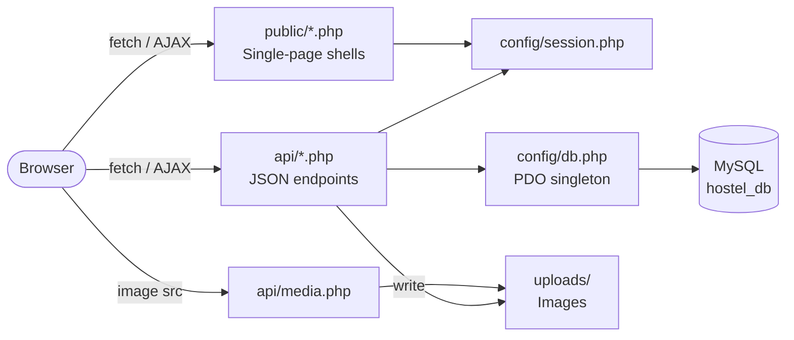
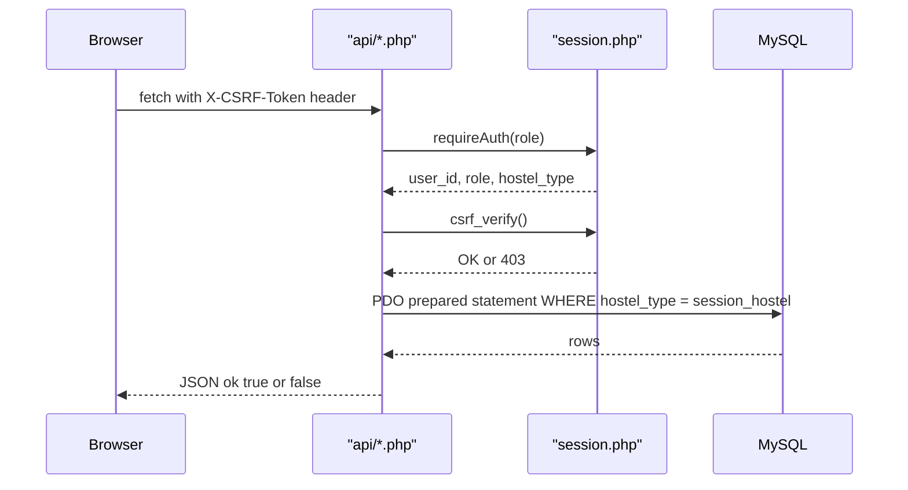
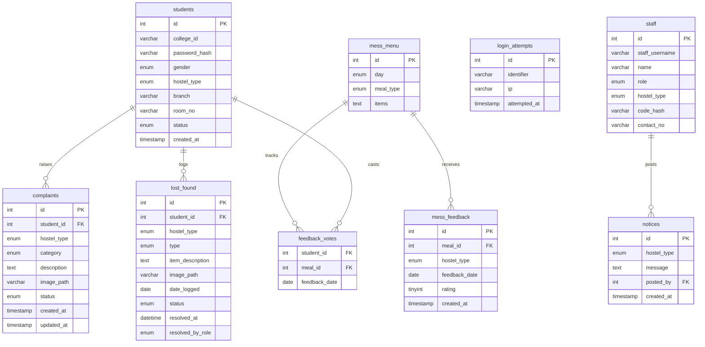

# Hostel Management System — IIIT Kota

A full-stack web application for managing boys' and girls' hostels at IIIT Kota.
Built with **plain HTML/CSS/JS + PHP 8 (PDO) + MySQL**, targeting **XAMPP**. No frameworks, no CDN, no build tools.

---

## Table of Contents

1. [Features](#features)
2. [Architecture](#architecture)
3. [Database Schema](#database-schema)
4. [Prerequisites](#prerequisites)
5. [Installation & Setup](#installation--setup)
6. [Running the App](#running-the-app)
7. [Demo Credentials](#demo-credentials)
8. [Test Walkthrough](#test-walkthrough)
9. [API Reference](#api-reference)
10. [Configuration & Customization](#configuration--customization)
11. [Upgrading an Existing Database](#upgrading-an-existing-database)
12. [Troubleshooting](#troubleshooting)
13. [Security Notes](#security-notes)
14. [Known Limitations](#known-limitations)
15. [Team Workflow](#team-workflow)

---

## Features

| Module | Student Portal | Staff Portal |
|---|---|---|
| **Authentication** | Register (IIIT Kota email format), login, idle-timeout logout | Login with username + access code |
| **Complaints** | Raise with optional photo (JPG/PNG/WebP, max 2 MB); view own complaints; track status | View hostel complaints (filter by category); mark in-progress / resolved |
| **Notices** | View notices for own hostel | Wardens: post and delete notices |
| **Mess Menu** | View shared weekly menu; rate today's meals (once per meal per day) | Wardens: edit menu items inline |
| **Mess Analytics** | — | View average ratings and feedback counts by day/meal |
| **Lost & Found** | Report lost/found items with optional photo (JPG/PNG/WebP, max 2 MB); view hostel listings; mark **own** posts resolved | View all hostel listings with type/status/text filters; thumbnail preview; mark **any** active listing resolved; **wardens can reopen** resolved listings; 30s auto-refresh |
| **Student Approval** | View own status (pending / approved / rejected) | Wardens: approve or reject pending registrations |
| **Emergency Contacts** | View hostel emergency contacts | — |

#### Lost & Found Permission Matrix

| Action | Student | Caretaker | Warden |
|---|---|---|---|
| View own hostel posts | Yes | Yes | Yes |
| Resolve a post | Own active posts only | Any active post in own hostel | Any active post in own hostel |
| Reopen a resolved post | No | No | Any resolved post in own hostel |
| Edit / delete a post | No | No | No |

*All cross-hostel actions are strictly rejected server-side with 403 Forbidden.*

**Security highlights:** PDO prepared statements, `ATTR_EMULATE_PREPARES=false`, role and hostel scope enforced server-side from `$_SESSION` only, CSRF token on every mutating request, brute-force rate limiting on login, `HttpOnly + SameSite=Strict` session cookies, 30-min idle timeout, uploaded files stored outside web root and streamed through `api/media.php`.

---

## Architecture

```
hostel_management/
├── config/
│   ├── db.php              ← PDO singleton (gitignored — copy from db.example.php)
│   ├── db.example.php      ← Template with XAMPP defaults
│   ├── session.php         ← Session hardening, requireAuth(), json_out(), csrf_token/verify()
│   └── contacts.php        ← Emergency contact data (static arrays)
├── api/                    ← One JSON endpoint per action
│   ├── auth_login_staff.php
│   ├── auth_login_student.php
│   ├── auth_logout.php
│   ├── auth_signup.php
│   ├── complaint_create.php   ← inline upload: 2 MB, JPG/PNG/WebP, finfo MIME check
│   ├── complaint_list.php
│   ├── complaint_status.php
│   ├── lostfound_create.php   ← inline upload: same rules as complaint_create
│   ├── lostfound_list.php
│   ├── lostfound_reopen.php   ← wardens only: reopen resolved listing
│   ├── lostfound_resolve.php  ← students (own) or staff (any in hostel)
│   ├── media.php              ← streams uploads after auth check
│   ├── menu_update.php
│   ├── mess_analytics.php
│   ├── mess_feedback.php
│   ├── mess_menu.php
│   ├── notice_create.php
│   ├── notice_delete.php
│   ├── notice_list.php
│   ├── staff_complaint_list.php
│   ├── staff_lostfound_list.php ← staff lost & found desk with resolution details
│   ├── student_decide.php
│   └── student_pending.php
├── public/
│   ├── index.php           ← Login / Sign-up portal
│   ├── student.php         ← Student single-page shell
│   ├── staff.php           ← Staff single-page shell
│   └── assets/
│       ├── css/style.css
│       └── js/app.js
├── uploads/                ← Uploaded images (gitignored except .htaccess + .gitkeep)
│   ├── .htaccess           ← Deny all direct web access (Apache only)
│   └── .gitkeep
├── schema.sql              ← Full DB schema + mess menu seed data (21 rows, 7 days × 3 meals)
├── seed_staff.php          ← Seeds 4 staff accounts (run once after import)
└── README.md
```

> [!NOTE]
> There is no shared upload helper file. The 2 MB size cap, extension allowlist (jpg/jpeg/png/webp), and finfo MIME verification are implemented inline in `api/complaint_create.php` and `api/lostfound_create.php`.

> [!TIP]
> **Static Asset Cache-Busting:** `public/index.php`, `public/student.php`, and `public/staff.php` automatically append timestamp query parameters (`?v=<?= filemtime(...) ?>`) to `style.css` and `app.js` so browsers always load updated assets immediately without stale script caching.



### Request Lifecycle



---

## Database Schema



**Key constraints:**

- `mess_menu`: `UNIQUE(day, meal_type)` — one row per day/meal combination. Meal types: `breakfast`, `lunch`, `dinner`.
- `feedback_votes`: composite PK `(student_id, meal_id, feedback_date)` — one rating per student per meal per day.
- `mess_feedback` and `feedback_votes` are **never joined** to protect anonymity.
- All student/complaint/notice/lost_found queries are scoped to `hostel_type = :session_hostel`.
- `mess_menu` is shared across both hostels (no hostel column); only wardens may edit it.
- `notices.posted_by` is a FK to `staff(id)` — cascades on delete.
- `complaints.image_path` and `lost_found.image_path` are nullable `VARCHAR(255)`; `NULL` means no attachment.

---

## Prerequisites

| Requirement | Version |
|---|---|
| XAMPP | 8.x (PHP 8.0+, Apache, MySQL/MariaDB) |
| Browser | Any modern browser (Chrome, Firefox, Safari, Edge) |
| OS | macOS, Windows, or Linux |

> [!IMPORTANT]
> Only XAMPP + Apache is supported. The PHP built-in server (`php -S`) does not honour `uploads/.htaccess` and is not tested. Use XAMPP.

---

## Installation & Setup

### Step 1 — Install XAMPP and start services

Download XAMPP from [apachefriends.org](https://www.apachefriends.org) and start **Apache** and **MySQL** from the XAMPP Control Panel.

### Step 2 — Clone directly into htdocs

Clone the repo with the folder name `hostel` so the URL path matches:

**macOS:**
```bash
cd /Applications/XAMPP/xamppfiles/htdocs
git clone https://github.com/srivastavaamishka-glitch/Hostel-Management-System-IIIT-KOTA-.git hostel
```

**Windows:**
```bash
cd C:\xampp\htdocs
git clone https://github.com/srivastavaamishka-glitch/Hostel-Management-System-IIIT-KOTA-.git hostel
```

> [!NOTE]
> Clone directly here — do not clone elsewhere and copy. Having two copies means edits in one place won't appear in the browser.

### Step 3 — Configure the database connection

```bash
# macOS / Linux
cp config/db.example.php config/db.php

# Windows
copy config\db.example.php config\db.php
```

The defaults in `db.example.php` (`host: 127.0.0.1`, `port: 3306`, `dbname: hostel_db`, `user: root`, `pass: ""`) work without changes on a standard XAMPP install. Edit `config/db.php` only if you changed the MySQL root password or port.

You can also override settings with environment variables: `DB_HOST`, `DB_PORT`, `DB_NAME`, `DB_USER`, `DB_PASS`.

> [!CAUTION]
> `config/db.php` is listed in `.gitignore`. Never commit it — it may contain your database password.

### Step 4 — Import the database schema

1. Open phpMyAdmin: `http://localhost/phpmyadmin`
2. Click **Import**, choose `schema.sql` from the project root, click **Go**.

This creates the `hostel_db` database (via `CREATE DATABASE IF NOT EXISTS`), all 9 tables, and seeds the 21-row mess menu (7 days × 3 meals: breakfast, lunch, dinner).

> [!NOTE]
> If you see "No database selected" after import, click on `hostel_db` in the left sidebar — the import creates it automatically.

### Step 5 — Seed staff accounts

**Primary method — CLI (recommended):**

```bash
# macOS
/Applications/XAMPP/xamppfiles/bin/php seed_staff.php

# Windows
C:\xampp\php\php.exe seed_staff.php
```

Expected output:
```
[CREATED] User 'warden_boys' created (ID: 1, warden, boys). Hash prefix: '$2y$'
[CREATED] User 'caretaker_boys' created (ID: 2, caretaker, boys). Hash prefix: '$2y$'
[CREATED] User 'warden_girls' created (ID: 3, warden, girls). Hash prefix: '$2y$'
[CREATED] User 'caretaker_girls' created (ID: 4, caretaker, girls). Hash prefix: '$2y$'
Summary: 4 created, 0 skipped.
```

Safe to re-run — it skips existing usernames.

**Fallback — browser (use on localhost only):**

```
http://localhost/hostel/seed_staff.php
```

> [!WARNING]
> Remove or restrict `seed_staff.php` on any shared or public network. It is a one-time setup script, not part of the app.

### Step 6 — Fix upload permissions (macOS only)

XAMPP's Apache typically runs as the `daemon` user on macOS. `chmod 755` on `uploads/` is not enough because `daemon` needs write permission.

```bash
# Option A — for a local demo (permissive)
chmod -R 777 /Applications/XAMPP/xamppfiles/htdocs/hostel/uploads

# Option B — correct ownership (preferred)
sudo chown -R daemon /Applications/XAMPP/xamppfiles/htdocs/hostel/uploads
chmod 755 /Applications/XAMPP/xamppfiles/htdocs/hostel/uploads
```

**Windows:** No permission changes needed; XAMPP on Windows runs with full write access by default.

---

## Running the App

With XAMPP Apache running, open:

```
http://localhost/hostel/public/index.php
```

| URL | Description |
|---|---|
| `http://localhost/hostel/public/index.php` | Login / sign-up portal |
| `http://localhost/hostel/public/student.php` | Student portal (after login) |
| `http://localhost/hostel/public/staff.php` | Staff portal (after login) |

---

## Demo Credentials

> [!IMPORTANT]
> Run Step 5 (seed staff) before logging in as staff. Student accounts require registration through the Sign-up tab.

### Staff Accounts (pre-seeded)

| Username | Access Code | Role | Hostel |
|---|---|---|---|
| `warden_boys` | `WardenBoys@123` | Warden | Boys |
| `caretaker_boys` | `CaretakerBoys@123` | Caretaker | Boys |
| `warden_girls` | `WardenGirls@123` | Warden | Girls |
| `caretaker_girls` | `CaretakerGirls@123` | Caretaker | Girls |

### Student Accounts

Students must register via the **Sign Up** tab on `index.php`. The college ID must match:

```
^20\d{2}ku[a-z]{2,5}\d{2,5}@(iiitkota|iiit\.kota)\.ac\.in$
```

**Format:** `20YYku<branch><roll>@iiitkota.ac.in` or `@iiit.kota.ac.in`

| Part | Rule | Example |
|---|---|---|
| Year | `20` + 2 digits | `2025` |
| Literal | `ku` | `ku` |
| Branch | 2–5 lowercase letters | `cs`, `cp`, `ec`, `mech` |
| Roll | 2–5 digits | `001`, `1010` |
| Domain | `iiitkota.ac.in` or `iiit.kota.ac.in` | either works |

**Valid examples:** `2025kucs001@iiitkota.ac.in`, `2024kucp1010@iiit.kota.ac.in`

**Gender** is chosen on the signup form and determines the hostel (`male` → boys, `female` → girls) — the ID format does not encode hostel.

**Password rule:** minimum 8 characters, at least one uppercase letter, one lowercase letter, one digit, and one special character (e.g. `Hostel@2025`). Enforced identically in `api/auth_signup.php` and in the live feedback shown in the sign-up form.

---

## Test Walkthrough

### 1. Register a student

- Go to `http://localhost/hostel/public/index.php` → **Sign Up** tab.
- College ID: `2025kucs001@iiitkota.ac.in`
- Password: `Hostel@2025` (must be ≥ 8 chars with uppercase, lowercase, digit, special char)
- Gender: Male (assigns boys hostel server-side)
- Branch: CSE, Room: A-101
- Submit → "Registration submitted. Awaiting warden approval."

### 2. Approve the student (Boys Warden)

- Open a new tab / Incognito. Log in as `warden_boys` / `WardenBoys@123` via **Staff Login**.
- Go to **Student Approvals** → approve `2025kucs001@iiitkota.ac.in`.

### 3. Log in as the student

- Return to the first tab. Log in with `2025kucs001@iiitkota.ac.in` and your password.

### 4. Test all student features

- **Complaints** → raise a complaint (category: Electrical, description: at least 10 characters). Optionally attach a JPG/PNG/WebP under 2 MB. Verify it appears with status "pending".
- **Notices** → view notices (post one as warden first to see something here).
- **Mess Menu** → view the weekly menu. Click a star on today's meal → toast "Rating saved!". Try rating again → rejected (one per day per meal).
- **Lost & Found** → report a lost item, optionally attach a photo. Verify it appears. Use **Mark Resolved** on your own post — the button only appears on posts you created. Other students' posts show no resolve button.

### 5. Test staff features (Caretaker)

- Log in as `caretaker_boys` / `CaretakerBoys@123`.
- **Complaints Desk** → update status to "in-progress", then "resolved". Badge color transitions.
- **Lost & Found Desk** → view all boys hostel listings.
  - Filter by Type (All / Lost / Found) and Status (Active / Resolved / All).
  - Search by item description or poster college ID; note the live item count updates.
  - Click any photo thumbnail to preview the full attachment in the modal.
  - Click **Mark Resolved** on any active listing → confirmation modal appears → confirm.
  - The row status transitions to "Resolved", displays the resolver role (`caretaker`) and timestamp, and fades out if "Active" filter is active.
  - Verify caretakers do *not* see a "Reopen" button on resolved items.

### 6. Test warden-only features

- Log in as `warden_boys` / `WardenBoys@123`.
- **Lost & Found Desk (Reopen)** → switch Status filter to "Resolved" or "All".
  - Click **Reopen** on any resolved post → confirmation modal appears → confirm.
  - The status badge transitions back to "Active" and the listing reappears under the "Active" filter.
- **Notices** → post a notice; verify it appears in the student portal.
- **Mess Menu Editor** → edit an item inline, save. Verify the update appears.
- **Mess Analytics** → view rating data (requires at least one student rating submitted first).
- **Student Approvals** → approve or reject pending registrations.

### 7. Test cross-hostel isolation

- Log in as `warden_girls` / `WardenGirls@123`.
- Verify only girls hostel students, complaints, notices, and lost-found items are visible.

---

## API Reference

All endpoints return `{"ok": bool, "data"?: ..., "error"?: string}`. All mutating endpoints require the `X-CSRF-Token` request header (sent automatically by `app.js`).

| Endpoint | Method | Auth | Description |
|---|---|---|---|
| `api/auth_login_student.php` | POST | — | Student login |
| `api/auth_login_staff.php` | POST | — | Staff login |
| `api/auth_signup.php` | POST | — | Student registration |
| `api/auth_logout.php` | POST | Any | Destroy session |
| `api/complaint_create.php` | POST | student | Raise a complaint (optional image upload) |
| `api/complaint_list.php` | GET | student | Own complaints |
| `api/complaint_status.php` | POST | staff | Update complaint status |
| `api/staff_complaint_list.php` | GET | staff | All hostel complaints |
| `api/notice_create.php` | POST | warden | Post a notice |
| `api/notice_delete.php` | POST | warden | Delete a notice |
| `api/notice_list.php` | GET | any | Hostel notices |
| `api/mess_menu.php` | GET | any | Weekly menu (shared, unfiltered) |
| `api/menu_update.php` | POST | warden | Edit a menu item |
| `api/mess_feedback.php` | POST | student | Submit meal rating (once per meal per day) |
| `api/mess_analytics.php` | GET | staff | Rating analytics |
| `api/lostfound_create.php` | POST | student | Report lost/found item (optional image upload) |
| `api/lostfound_list.php` | GET | any | Hostel lost & found listings |
| `api/staff_lostfound_list.php` | GET | staff | Staff lost & found desk with resolution details |
| `api/lostfound_resolve.php` | POST | student (own) or staff (any in hostel) | Mark listing resolved |
| `api/lostfound_reopen.php` | POST | warden | Reopen a resolved listing |
| `api/media.php` | GET | authenticated | Stream complaint or lost-found attachment |
| `api/student_pending.php` | GET | staff | Pending registrations |
| `api/student_decide.php` | POST | warden | Approve or reject student |

---

## Configuration & Customization

### Change database credentials

Edit `config/db.php` only (never commit it). Or set environment variables: `DB_HOST`, `DB_PORT`, `DB_NAME`, `DB_USER`, `DB_PASS`.

### Change staff access codes

**Step 1 — generate a new bcrypt hash:**

```bash
# macOS / Linux
php -r "echo password_hash('NewPassword@123', PASSWORD_BCRYPT);"

# Windows (use escaped quotes)
C:\xampp\php\php.exe -r "echo password_hash('NewPassword@123', PASSWORD_BCRYPT);"
```

Copy the full output (starts with `$2y$`). The hash is always 60 characters — `staff.code_hash` is `VARCHAR(255)`, so length is never an issue.

**Step 2 — update in phpMyAdmin SQL tab:**

```sql
UPDATE staff SET code_hash = '<paste-hash-here>' WHERE staff_username = 'warden_boys';
```

The hash goes inside the single quotes, replacing `<paste-hash-here>`.

### Edit emergency contacts

Edit `config/contacts.php` — static PHP arrays, clearly marked as sample data.

### Add a new meal type

This requires changes in multiple places:

```sql
ALTER TABLE mess_menu
  MODIFY meal_type ENUM('breakfast','lunch','snacks','dinner') NOT NULL;
```

Also update the `FIELD(meal_type, ...)` ORDER BY clause in `api/mess_menu.php` and `api/mess_analytics.php`, and any hardcoded meal-type arrays in `public/assets/js/app.js`.

### Upload limits

The app enforces a **2 MB** per-file cap in `api/complaint_create.php` and `api/lostfound_create.php`. PHP itself must also allow at least this size:

- `upload_max_filesize = 2M` (or higher)
- `post_max_size = 8M` (or higher)

Edit these in XAMPP Control Panel → Config → `php.ini`, then restart Apache.

---

## Upgrading an Existing Database

If you set up the database before a later version of the schema was committed, run these one-time migrations in phpMyAdmin's SQL tab.

### Add image support to complaints

If your `complaints` table does not have an `image_path` column:

```sql
ALTER TABLE complaints
  ADD COLUMN image_path VARCHAR(255) NULL DEFAULT NULL
  AFTER description;
```

### Add resolution tracking to lost & found

If you created your database before staff resolution tracking was added:

```sql
ALTER TABLE lost_found
  ADD COLUMN resolved_at DATETIME NULL AFTER status,
  ADD COLUMN resolved_by_role ENUM('student','warden','caretaker') NULL AFTER resolved_at;
```

Existing resolved rows will keep `NULL` for both columns (the UI displays these as em dashes). Fresh resolutions populate `resolved_at` with the timestamp and `resolved_by_role` with `'student'`, `'warden'`, or `'caretaker'`. Reopening a listing by a warden resets both columns to `NULL`.

### Add snacks meal type

If you want to add a snacks meal slot between lunch and dinner:

```sql
ALTER TABLE mess_menu
  MODIFY meal_type ENUM('breakfast','lunch','snacks','dinner') NOT NULL;

INSERT IGNORE INTO mess_menu (day, meal_type, items) VALUES
  ('Mon', 'snacks', 'Tea, Samosa'),
  ('Tue', 'snacks', 'Tea, Biscuits'),
  ('Wed', 'snacks', 'Coffee, Veg Sandwich'),
  ('Thu', 'snacks', 'Tea, Poha'),
  ('Fri', 'snacks', 'Tea, Pakora'),
  ('Sat', 'snacks', 'Coffee, Bread Pakora'),
  ('Sun', 'snacks', 'Tea, Cake Slice');
```

Then update `FIELD(meal_type, 'breakfast', 'lunch', 'snacks', 'dinner')` in `api/mess_menu.php` and `api/mess_analytics.php`.

> [!NOTE]
> The current `schema.sql` does not include snacks. Fresh installs get breakfast/lunch/dinner only.

---

## Troubleshooting

### "config/db.php not found"

You have not copied the example config:

```bash
cp config/db.example.php config/db.php
```

### "Database connection failed. Please ensure MySQL is running..."

MySQL is not running. Start it in XAMPP Control Panel, then try again. Also check for port conflicts — MySQL default is 3306.

### "No database selected" in phpMyAdmin after import

The import ran `CREATE DATABASE IF NOT EXISTS hostel_db` and then `USE hostel_db`, so all tables are inside `hostel_db`. Click on `hostel_db` in the left sidebar of phpMyAdmin; the tables should appear there.

### Students can't log in after registering

A warden must approve the registration first. Log in as a warden and go to the **Student Approvals** tab.

### Changes or listings not showing in browser

1. **Working directory vs XAMPP web root:** Verify whether you are editing files in your project directory (e.g. `~/Desktop/hostel_management/`) while Apache is serving from `htdocs/hostel/`. Sync the files or clone directly into `htdocs/hostel` per Step 2.
2. **Browser Asset Caching:** All public pages use `?v=<?= filemtime(...) ?>` cache busters on `style.css` and `app.js`. If you ever see stale interface behavior or 404s on newly added API endpoints, perform a hard refresh: **Ctrl+Shift+R** (Windows/Linux) or **Cmd+Shift+R** (macOS).
3. **Database Migration:** If Lost & Found listings fail to load or resolve, verify that the `resolved_at` and `resolved_by_role` columns exist in `lost_found` (see [Upgrading an Existing Database](#upgrading-an-existing-database)).

### File uploads not working

1. **PHP limits:** ensure `upload_max_filesize` ≥ 2M and `post_max_size` ≥ 8M in `php.ini` (XAMPP Control Panel → Config → php.ini → restart Apache).
2. **App cap:** the app rejects any file over 2 MB regardless of php.ini — this is intentional.
3. **Permissions (macOS):** Apache runs as `daemon`; run `sudo chown -R daemon uploads/` or `chmod -R 777 uploads/` for a local demo.
4. **Windows:** no permission changes needed.
5. Direct URL access to `/uploads/*.jpg` returns 403 — this is correct. Images are served through `api/media.php`.

### Using MAMP instead of XAMPP

MAMP's MySQL runs on port **8889** by default (not 3306). Edit `config/db.php`:

```php
$port = getenv('DB_PORT') !== false ? (string)getenv('DB_PORT') : '8889';
```

Or set the `DB_PORT=8889` environment variable. MAMP's PHP binary is at `/Applications/MAMP/bin/php/phpX.X.X/bin/php`.

### Session issues / always redirected to login

Ensure cookies are enabled in your browser for `localhost`. Sessions use `HttpOnly + SameSite=Strict` cookies.

---

## Security Notes

> [!CAUTION]
> This project is designed for local XAMPP use as a college demo. Before any production deployment:

- Change all default passwords in `config/db.php` and re-run `seed_staff.php` with new access codes.
- Enable HTTPS and set `'secure' => true` in the session cookie params in `config/session.php`.
- Move `uploads/` entirely outside the web root (not just `.htaccess`-protected).
- Remove or restrict access to `seed_staff.php`.
- Review and add Content Security Policy headers.

---

## Known Limitations

- **Lost & Found resolution permissions:** students can resolve only their own active listings. Staff (warden and caretaker) can resolve any active listing in their hostel. Wardens can additionally reopen resolved listings, restoring their status to active. All actions record resolution audit metadata (`resolved_at`, `resolved_by_role`) or reset them upon reopen.
- **Password complexity:** enforced client-side (live feedback) and server-side (PHP). Rules: min 8 characters, at least one uppercase letter, one lowercase letter, one digit, and one special character.
- **No email verification:** college ID format is validated by regex but no actual email is sent.
- **snacks meal type:** not in the current schema. See [Upgrading an Existing Database](#upgrading-an-existing-database) to add it.
- **PHP built-in server not supported:** `uploads/.htaccess` has no effect without Apache. Use XAMPP only.

---

## Team Workflow

```bash
# Before starting work — always pull first
git pull origin main

# After making changes — small, focused commits
git add <changed-files>
git commit -m "Short description of what changed"
git push origin main
```

> [!IMPORTANT]
> **Never commit:**
> - `config/db.php` — it is in `.gitignore`; it contains your local database password
> - Files in `uploads/` — real user images are gitignored via `uploads/*`
> - `.DS_Store`, `.idea/`, `.vscode/` — also gitignored

If `config/db.php` ever appears in `git status` as tracked, remove it from git's index:

```bash
git rm --cached config/db.php
git commit -m "Remove db.php from tracking"
```

---

*IIIT Kota — Hostel Management System · College Project*
